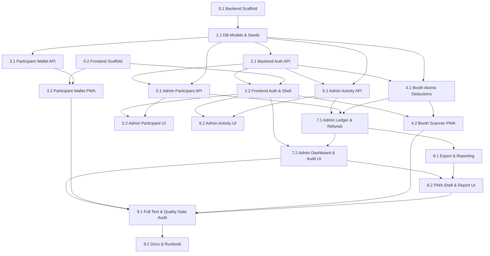

# Implementation Plan: Sepa Island Activity Wallet

**Document Status:** Pending Approval  
**Version:** 1.0.0  
**Source Specification:** [`SPEC.md`](file:///c:/Users/Admin/Documents/Repositories/Activity_Wallet/SPEC.md)  
**Governing Rules:** [`AGENTS.md`](file:///c:/Users/Admin/Documents/Repositories/Activity_Wallet/AGENTS.md)  

---

## 1. Overview & Architectural Goals

The goal of this implementation plan is to build the **Sepa Island Activity Wallet** from ground up into a robust, high-performance, and auditable event credit management system.

The implementation is structured into **10 dependency-ordered vertical slices (Tasks 0.1 through 9.2)**. Each slice contains full stack or observable behavioral units, comprehensive automated tests (minimum 90% lines/functions, 85% branches), strict error envelopes, and rollback-friendly boundaries.

---

## 2. Dependency Graph & Checkpoint Strategy

### Checkpoints:
- **Checkpoint A (Core Foundation & Auth):** After Slice 2 (Tasks 0.1 - 2.2). Backend starts, DB connects, auth works end-to-end.
- **Checkpoint B (Core Operations - Participant & Booth):** After Slice 4 (Tasks 3.1 - 4.2). QR wallet viewing, scanning, atomic transactions with concurrency locks verified.
- **Checkpoint C (Administration & Audit Ledger):** After Slice 7 (Tasks 5.1 - 7.2). Full participant/activity management, audit ledger, and refund engine active.
- **Checkpoint D (System Ready & Hardened):** After Slice 9 (Tasks 8.1 - 9.2). Exports, offline PWA caching, coverage ≥ 90%, all verification checks passed.

---

## 3. Detailed Task Breakdown

### Slice 0: Foundation & Scaffolding

#### Task 0.1: Backend Project Foundation & Scaffolding
- **Objective:** Establish the Express.js application skeleton with centralized middleware, standard response envelopes, Winston logging, SQLite/Postgres configuration, and Jest test runner.
- **Dependencies:** None
- **Likely Files:**
  - `backend/package.json`
  - `backend/src/app.js`
  - `backend/src/server.js`
  - `backend/src/config/database.js`
  - `backend/src/config/logger.js`
  - `backend/src/middleware/errorHandler.js`
  - `backend/src/middleware/rateLimiter.js`
  - `backend/src/utils/responseEnvelope.js`
  - `backend/tests/unit/responseEnvelope.test.js`
  - `backend/tests/integration/health.test.js`
- **Implementation Outline:**
  1. Initialize `package.json` with scripts (`dev`, `test`, `start`, `lint`).
  2. Configure Winston logger with JSON formatting and daily rotation in `src/logs/`.
  3. Create standard response envelope helper (`formatSuccess`, `formatError`).
  4. Create Express app with Helmet, CORS, body parsers, rate limiting, and centralized error handler.
  5. Setup database configuration supporting SQLite for dev/test and PostgreSQL via environment variables.
  6. Add health check route `GET /api/v1/health`.
- **Acceptance Criteria:**
  - `GET /api/v1/health` returns `{ success: true, data: { status: 'healthy', timestamp: ... } }`.
  - Uncaught errors return standard `{ success: false, error: { code, message } }`.
  - Winston logs HTTP requests and errors in JSON format.
- **Required Tests:**
  - Unit tests for response envelope formatter.
  - Integration test for health check endpoint and centralized error handler.
- **Verification Commands:**
  - `rtk cd backend && npm run test`
  - `rtk cd backend && npm run lint`
- **Risk & Rollback:** Low risk. Rollback: delete generated `backend/` files.

---

#### Task 0.2: Frontend Foundation & Design Tokens
- **Objective:** Scaffold React 18 application with Vite, define outdoor high-contrast CSS design tokens, base typography, global toast notification context, and layout shell.
- **Dependencies:** None
- **Likely Files:**
  - `frontend/package.json`
  - `frontend/vite.config.js`
  - `frontend/src/main.jsx`
  - `frontend/src/App.jsx`
  - `frontend/src/styles/theme.css`
  - `frontend/src/styles/index.css`
  - `frontend/src/context/ToastContext.jsx`
  - `frontend/src/components/common/Header.jsx`
  - `frontend/src/components/common/Toast.jsx`
  - `frontend/tests/components/Toast.test.jsx`
- **Implementation Outline:**
  1. Configure Vite with React and testing setup (`vitest`, `@testing-library/react`).
  2. Define CSS variables: vibrant high-contrast sunlight palette (deep slate `#0f172a`, ocean cyan `#0ea5e9`, vibrant emerald `#10b981`, amber `#f59e0b`, coral red `#ef4444`), touch target standards (min 48px).
  3. Build `ToastContext` and `Toast` component for instant visual alerts.
  4. Create basic responsive application shell with navigation header.
- **Acceptance Criteria:**
  - Vite dev server starts with zero console errors.
  - Design tokens provide distinct sunlight readability and accessible contrast (> 4.5:1).
  - Toast provider displays success/error notifications with auto-dismiss.
- **Required Tests:**
  - Unit test for Toast provider and auto-dismiss behavior.
- **Verification Commands:**
  - `rtk cd frontend && npm run test`
  - `rtk cd frontend && npm run build`
- **Risk & Rollback:** Low risk. Rollback: delete generated `frontend/` files.

---

### Slice 1: Core Domain Entities & Database Migrations

#### Task 1.1: Sequelize Models, Associations, Indexes & Seeders
- **Objective:** Implement domain models (`User`, `Participant`, `Activity`, `Transaction`), establish foreign key associations, unique indexes, and create realistic seed data.
- **Dependencies:** Task 0.1
- **Likely Files:**
  - `backend/src/models/User.js`
  - `backend/src/models/Participant.js`
  - `backend/src/models/Activity.js`
  - `backend/src/models/Transaction.js`
  - `backend/src/models/index.js`
  - `backend/src/constants/enums.js`
  - `backend/src/database/seed.js`
  - `backend/tests/unit/models.test.js`
- **Implementation Outline:**
  1. Define enums: User roles (`ADMIN`, `STAFF`), Participant status (`ACTIVE`, `BLOCKED`), Activity status (`ACTIVE`, `INACTIVE`), Transaction types (`DEDUCTION`, `REFUND`, `ADJUSTMENT`).
  2. Define `User` model (bcrypt hashing hook, username index).
  3. Define `Participant` model (unique indexed `qr_code`, default 1,000,000 credit, non-negative balance constraint).
  4. Define `Activity` model (name, price integer, active flag).
  5. Define `Transaction` model (immutable, balance before/after snapshots, foreign keys to participant, activity, staff, and self-referencing `reference_id`).
  6. Setup model associations in `models/index.js`.
  7. Write seed script creating default Admin (`admin`/`admin123`), Staff accounts for booths, standard activities (Jet Ski: Rp350.000, Banana Boat: Rp150.000, Donut Boat: Rp175.000, Snorkeling: Rp200.000), and ~10 sample participants with Rp1.000.000.
- **Acceptance Criteria:**
  - All models sync successfully with SQLite and PostgreSQL schemas.
  - Seeder populates initial data idempotently.
  - Foreign key constraints and unique indexes (`qr_code`, `username`) are enforced.
- **Required Tests:**
  - Unit tests verifying model validation, hooks, default balance, and association integrity.
- **Verification Commands:**
  - `rtk cd backend && npm run test`
  - `rtk cd backend && node src/database/seed.js`
- **Risk & Rollback:** Low risk. Rollback: revert `backend/src/models` and seed files.

---

### Slice 2: Authentication & Role-Based Access Control

#### Task 2.1: Backend Authentication API & Role Middleware
- **Objective:** Implement login, token verification, role enforcement middlewares (`requireAuth`, `requireRole`), and session profile endpoint.
- **Dependencies:** Task 1.1
- **Likely Files:**
  - `backend/src/services/authService.js`
  - `backend/src/controllers/authController.js`
  - `backend/src/routes/authRoutes.js`
  - `backend/src/middleware/authMiddleware.js`
  - `backend/src/schemas/authSchemas.js`
  - `backend/tests/unit/authService.test.js`
  - `backend/tests/integration/auth.test.js`
- **Implementation Outline:**
  1. Create Joi validation schemas for login payload (`username`, `password`).
  2. Implement `authService.login` with bcrypt verification and JWT generation.
  3. Build `requireAuth` middleware to verify Bearer tokens and attach `req.user`.
  4. Build `requireRole(role)` middleware for route authorization (`STAFF`, `ADMIN`).
  5. Add routes `POST /api/v1/auth/login` and `GET /api/v1/auth/me`.
- **Acceptance Criteria:**
  - Valid credentials return 200 with JWT and user profile (role, assigned booth).
  - Invalid credentials return 401 with standard error envelope.
  - Protected endpoints reject missing or invalid tokens with 401 and role mismatches with 403.
- **Required Tests:**
  - Unit tests for password comparison and JWT token creation.
  - Integration tests for `/api/v1/auth/login`, `/api/v1/auth/me`, and role guards.
- **Verification Commands:**
  - `rtk cd backend && npm run test`
- **Risk & Rollback:** Medium risk. Rollback: revert auth routes, middleware, and controllers.

---

#### Task 2.2: Frontend Auth State, Login View & Protected Routes
- **Objective:** Create React AuthContext, persistent session handler, login interface, and role-guarded route components.
- **Dependencies:** Task 0.2, Task 2.1
- **Likely Files:**
  - `frontend/src/api/authApi.js`
  - `frontend/src/context/AuthContext.jsx`
  - `frontend/src/components/common/ProtectedRoute.jsx`
  - `frontend/src/pages/LoginView.jsx`
  - `frontend/tests/context/AuthContext.test.jsx`
  - `frontend/tests/pages/LoginView.test.jsx`
- **Implementation Outline:**
  1. Build API client wrapper with automatic Authorization header injection.
  2. Implement `AuthContext` with `login`, `logout`, token persistence, and current user state.
  3. Create `ProtectedRoute` component verifying user login and required role (`STAFF` or `ADMIN`).
  4. Build high-contrast, responsive `LoginView` with role selector / auto-redirection.
- **Acceptance Criteria:**
  - Logging in as Staff redirects to `/booth`; Admin redirects to `/admin`.
  - Unauthenticated access to protected routes redirects to `/login`.
  - Logged in state survives browser refresh via token verification.
- **Required Tests:**
  - Unit tests for `AuthContext` login/logout flows.
  - Component test for `LoginView` form validation and submission.
- **Verification Commands:**
  - `rtk cd frontend && npm run test`
- **Risk & Rollback:** Low risk. Rollback: revert auth views and context.

---

### Slice 3: Participant Wallet & Public Token Interface

#### Task 3.1: Backend Participant Wallet Lookup API
- **Objective:** Provide a public read-only endpoint for participants to lookup wallet status, remaining balance, spent credit, activity catalog with affordability flags, and transaction history using their QR token string.
- **Dependencies:** Task 1.1
- **Likely Files:**
  - `backend/src/services/participantService.js`
  - `backend/src/controllers/participantController.js`
  - `backend/src/routes/participantRoutes.js`
  - `backend/src/schemas/participantSchemas.js`
  - `backend/tests/unit/participantService.test.js`
  - `backend/tests/integration/participantWallet.test.js`
- **Implementation Outline:**
  1. Implement `participantService.getWalletByQrCode(qrCode)`:
     - Query participant by indexed `qr_code`.
     - Return 404 if not found; return blocked notice if `status === 'BLOCKED'`.
     - Fetch all active activities and calculate `is_affordable: (current_balance >= activity.price)`.
     - Fetch participant's chronological transaction history (latest first).
  2. Mount `GET /api/v1/participants/wallet/:qrCode`.
- **Acceptance Criteria:**
  - Returns participant name, starting credit (1,000,000), current balance, total spent.
  - Returns activity list with `is_affordable` accurately computed for each item.
  - Returns personal transaction history with dates, amounts, and activity names.
  - Invalid QR tokens return 404 with error code `PARTICIPANT_NOT_FOUND`.
- **Required Tests:**
  - Unit tests for affordability calculation logic.
  - Integration tests for `/api/v1/participants/wallet/:qrCode` (active, blocked, and non-existent QR).
- **Verification Commands:**
  - `rtk cd backend && npm run test`
- **Risk & Rollback:** Low risk. Rollback: remove participant wallet routes and service methods.

---

#### Task 3.2: Frontend Participant PWA View & QR Display
- **Objective:** Create the Participant PWA view displaying high-contrast wallet balance card, scannable personal QR code, real-time activity catalog with affordability status, and personal transaction feed.
- **Dependencies:** Task 0.2, Task 3.1
- **Likely Files:**
  - `frontend/src/api/participantApi.js`
  - `frontend/src/hooks/useParticipantWallet.js`
  - `frontend/src/components/participant/BalanceCard.jsx`
  - `frontend/src/components/participant/QRViewer.jsx`
  - `frontend/src/components/participant/ActivityCatalog.jsx`
  - `frontend/src/components/participant/TransactionList.jsx`
  - `frontend/src/pages/ParticipantView.jsx`
  - `frontend/tests/pages/ParticipantView.test.jsx`
- **Implementation Outline:**
  1. Build `useParticipantWallet` hook for data fetching, caching, and manual pull-to-refresh.
  2. Implement `BalanceCard` displaying remaining balance (large typography), initial credit, and total spent.
  3. Implement `QRViewer` rendering scannable high-resolution QR using `qrcode.react` with fullscreen expansion modal.
  4. Implement `ActivityCatalog` displaying grid of activities with distinct badges ("Tersedia" in green vs "Saldo Tidak Cukup" in muted amber).
  5. Implement `TransactionList` showing chronological debit and refund records with formatted timestamps and amounts.
  6. Assemble `ParticipantView` with outdoor high-contrast styling and sunlight readability.
- **Acceptance Criteria:**
  - Participant view renders seamlessly on mobile screen widths (320px to 480px).
  - QR code renders clearly and is easily scannable from a 20-30cm distance.
  - Real-time balance and activity affordability badges update accurately.
- **Required Tests:**
  - Component tests for `BalanceCard`, `QRViewer`, and `ActivityCatalog` affordability rendering.
- **Verification Commands:**
  - `rtk cd frontend && npm run test`
- **Risk & Rollback:** Low risk. Rollback: revert participant components and page.

---

### Slice 4: Booth Scanning & Atomic Debit Transactions

#### Task 4.1: Backend Booth Scan, Atomic Deduction & Concurrency Locking
- **Objective:** Implement booth QR scan lookup and atomic credit deduction engine with strict database row-level locking (`LOCK.UPDATE`), non-negative balance invariant check, and append-only transaction ledgering.
- **Dependencies:** Task 1.1, Task 2.1
- **Likely Files:**
  - `backend/src/services/transactionService.js`
  - `backend/src/controllers/boothController.js`
  - `backend/src/routes/boothRoutes.js`
  - `backend/src/schemas/boothSchemas.js`
  - `backend/tests/unit/transactionService.test.js`
  - `backend/tests/integration/boothTransactions.test.js`
  - `backend/tests/concurrency/doubleSpend.test.js`
- **Implementation Outline:**
  1. Joi schema for scan payload (`qr_code`) and deduction payload (`qr_code`, `activity_id`, `notes`).
  2. Implement `POST /api/v1/booth/scan`:
     - Validate staff token.
     - Lookup participant and active activities with eligibility flags.
  3. Implement `POST /api/v1/booth/transactions` inside `sequelize.transaction`:
     - Fetch participant with `lock: transaction.LOCK.UPDATE`.
     - Invariant checks: participant status === `ACTIVE`, activity status === `ACTIVE`.
     - Invariant check: `participant.current_balance >= activity.price`. If not, rollback and return 422 `INSUFFICIENT_BALANCE`.
     - Update participant: `current_balance = current_balance - activity.price`, `total_spent = total_spent + activity.price`.
     - Insert immutable `Transaction` record (`type: 'DEDUCTION'`, `balance_before`, `balance_after`, `staff_id`, `activity_id`).
     - Commit transaction and emit Winston structured log.
  4. Implement `GET /api/v1/booth/transactions/recent` returning last 20 booth transactions for authenticated staff.
- **Acceptance Criteria:**
  - Successful deduction returns 200 with new balance and transaction receipt.
  - Deduction rejected if price exceeds balance; balance remains unchanged.
  - Concurrency test proves simultaneous requests never overdraw or create negative balances.
  - Write-once transaction ledger invariant enforced (no update/delete).
- **Required Tests:**
  - Unit tests for transaction calculation and edge balances (exact balance match).
  - Integration tests for `/api/v1/booth/scan` and `/api/v1/booth/transactions`.
  - Concurrency race-condition test executing simultaneous requests on a single wallet.
- **Verification Commands:**
  - `rtk cd backend && npm run test`
- **Risk & Rollback:** High risk (financial core). Rollback: revert transaction service and booth routes.

---

#### Task 4.2: Frontend Booth Scanner PWA View & Transaction Confirmation
- **Objective:** Build the Booth Staff PWA interface with integrated camera scanner, manual QR token input fallback, participant balance preview, activity deduction modal, instant haptic/audio/visual confirmation feedback, and recent transaction feed.
- **Dependencies:** Task 0.2, Task 2.2, Task 4.1
- **Likely Files:**
  - `frontend/src/api/boothApi.js`
  - `frontend/src/hooks/useBoothScanner.js`
  - `frontend/src/components/booth/ScannerView.jsx`
  - `frontend/src/components/booth/ParticipantPreviewModal.jsx`
  - `frontend/src/components/booth/DeductConfirmModal.jsx`
  - `frontend/src/components/booth/RecentTransactionsFeed.jsx`
  - `frontend/src/pages/BoothView.jsx`
  - `frontend/tests/pages/BoothView.test.jsx`
- **Implementation Outline:**
  1. Build QR scanner component wrapping `html5-qrcode` with continuous scanning and camera switch support.
  2. Implement manual QR code input fallback for damaged wristbands or low light.
  3. Build `ParticipantPreviewModal` showing participant name, large balance badge, and quick activity selection buttons.
  4. Build `DeductConfirmModal` preventing accidental double taps with single-action lock and loading spinner.
  5. Add instant success screen with green checkmark banner, sound/vibration cue, remaining balance display, and auto-reset after 3 seconds.
  6. Add `RecentTransactionsFeed` showing the staff member's last processed transactions.
- **Acceptance Criteria:**
  - Staff can scan a QR code or type token manually in < 500ms.
  - Insufficient balance prompts an obvious high-contrast warning banner and disables confirmation button.
  - Successful deduction shows instant clear confirmation and updates recent feed.
- **Required Tests:**
  - Component tests for scanner trigger, preview modal balance display, and modal deduction submission.
- **Verification Commands:**
  - `rtk cd frontend && npm run test`
- **Risk & Rollback:** Medium risk. Rollback: revert booth components and views.

---

### Slice 5: Admin Participant Management & QR Reissuance

#### Task 5.1: Backend Admin Participant Management & QR Reissuance API
- **Objective:** Implement admin endpoints for participant listing, single creation, batch CSV/JSON import, participant status blocking/unblocking, and secure QR reissuance.
- **Dependencies:** Task 1.1, Task 2.1
- **Likely Files:**
  - `backend/src/services/adminParticipantService.js`
  - `backend/src/controllers/adminParticipantController.js`
  - `backend/src/routes/adminRoutes.js`
  - `backend/src/schemas/adminSchemas.js`
  - `backend/tests/unit/adminParticipantService.test.js`
  - `backend/tests/integration/adminParticipants.test.js`
- **Implementation Outline:**
  1. Add Joi schemas for participant creation, bulk import, and status update.
  2. Implement `GET /api/v1/admin/participants` (pagination, search by name/QR, filter by status).
  3. Implement `POST /api/v1/admin/participants` (create single or bulk array of names with default 1,000,000 credit and unique generated QR tokens).
  4. Implement `PUT /api/v1/admin/participants/:id/reissue-qr`:
     - Generate a new unique QR token (e.g. `SEPA-XXXXXX`).
     - Update participant's `qr_code`.
     - Retain participant's balance, spent credit, and full transaction history.
  5. Implement `PUT /api/v1/admin/participants/:id/status` (`ACTIVE` / `BLOCKED`).
- **Acceptance Criteria:**
  - Admin can list participants with accurate search and pagination.
  - Bulk import creates 80+ participants efficiently in a single managed transaction.
  - Reissuing QR invalidates old QR immediately, binds new QR, and preserves exact wallet balance and history.
- **Required Tests:**
  - Unit tests for QR token generator uniqueness and batch creation logic.
  - Integration tests for participant listing, creation, status toggle, and QR reissuance.
- **Verification Commands:**
  - `rtk cd backend && npm run test`
- **Risk & Rollback:** Medium risk. Rollback: revert admin participant service and routes.

---

#### Task 5.2: Frontend Admin Participant Manager & QR Reissuance UI
- **Objective:** Build Admin participant table with search, status filters, new participant/bulk import modal, block/unblock actions, and QR reissuance / print preview modal.
- **Dependencies:** Task 0.2, Task 2.2, Task 5.1
- **Likely Files:**
  - `frontend/src/api/adminApi.js`
  - `frontend/src/hooks/useAdminParticipants.js`
  - `frontend/src/components/admin/ParticipantTable.jsx`
  - `frontend/src/components/admin/ParticipantModal.jsx`
  - `frontend/src/components/admin/BulkImportModal.jsx`
  - `frontend/src/components/admin/ReissueQRModal.jsx`
  - `frontend/src/pages/AdminParticipantsView.jsx`
  - `frontend/tests/pages/AdminParticipantsView.test.jsx`
- **Implementation Outline:**
  1. Build `useAdminParticipants` hook managing query parameters, pagination, and mutation actions.
  2. Implement `ParticipantTable` with status badges, balance display, and action buttons.
  3. Build `ParticipantModal` and `BulkImportModal` for name list entry.
  4. Build `ReissueQRModal` displaying newly generated QR with one-click print/download capability.
- **Acceptance Criteria:**
  - Table dynamically filters and searches participants.
  - Reissuing a QR updates the table row immediately and shows the printable new QR.
  - Modals feature proper validation and loading state disables.
- **Required Tests:**
  - Component tests for `ParticipantTable` filtering and `ReissueQRModal` interaction.
- **Verification Commands:**
  - `rtk cd frontend && npm run test`
- **Risk & Rollback:** Low risk. Rollback: revert admin participant UI files.

---

### Slice 6: Admin Activity Catalog & Pricing Management

#### Task 6.1: Backend Admin Activity CRUD API
- **Objective:** Implement admin endpoints to create, update, price-configure, and activate/deactivate water sport activities.
- **Dependencies:** Task 1.1, Task 2.1
- **Likely Files:**
  - `backend/src/services/adminActivityService.js`
  - `backend/src/controllers/adminActivityController.js`
  - `backend/src/schemas/activitySchemas.js`
  - `backend/tests/unit/adminActivityService.test.js`
  - `backend/tests/integration/adminActivities.test.js`
- **Implementation Outline:**
  1. Joi schemas for activity payload (`name`, `price`, `description`, `status`).
  2. Implement `GET /api/v1/admin/activities` (listing all active and inactive activities).
  3. Implement `POST /api/v1/admin/activities` (create activity with unique name check).
  4. Implement `PUT /api/v1/admin/activities/:id` (update name, price, description, status).
- **Acceptance Criteria:**
  - Admin can add or edit activities with validation (price cannot be negative).
  - Deactivated activities are omitted from public participant and booth catalogs.
- **Required Tests:**
  - Unit tests for activity validation and unique naming.
  - Integration tests for activity CRUD endpoints.
- **Verification Commands:**
  - `rtk cd backend && npm run test`
- **Risk & Rollback:** Low risk. Rollback: revert activity routes and service.

---

#### Task 6.2: Frontend Admin Activity Manager UI
- **Objective:** Build the Admin activity management interface for browsing activities, editing prices, toggling active states, and adding new activities.
- **Dependencies:** Task 0.2, Task 2.2, Task 6.1
- **Likely Files:**
  - `frontend/src/hooks/useAdminActivities.js`
  - `frontend/src/components/admin/ActivityTable.jsx`
  - `frontend/src/components/admin/ActivityModal.jsx`
  - `frontend/src/pages/AdminActivitiesView.jsx`
  - `frontend/tests/pages/AdminActivitiesView.test.jsx`
- **Implementation Outline:**
  1. Build `useAdminActivities` hook for querying and mutating activities.
  2. Implement `ActivityTable` displaying activity name, formatted price (e.g. `Rp 350.000`), status toggle, and edit action.
  3. Implement `ActivityModal` form with currency input mask and description field.
- **Acceptance Criteria:**
  - Price updates and status toggles reflect immediately in the interface.
  - Form validation prevents invalid prices (< 0) or empty names.
- **Required Tests:**
  - Component tests for activity listing, price formatting, and form submissions.
- **Verification Commands:**
  - `rtk cd frontend && npm run test`
- **Risk & Rollback:** Low risk. Rollback: revert admin activity UI files.

---

### Slice 7: Admin Event Monitoring, Audit Ledger & Authorized Refunds

#### Task 7.1: Backend Admin Metrics, Audit Ledger & Refund Engine
- **Objective:** Implement real-time dashboard summary metrics, full audit ledger listing with filters, and authorized atomic refund processing.
- **Dependencies:** Task 4.1, Task 5.1, Task 6.1
- **Likely Files:**
  - `backend/src/services/adminReportService.js`
  - `backend/src/services/refundService.js`
  - `backend/src/controllers/adminTransactionController.js`
  - `backend/src/schemas/refundSchemas.js`
  - `backend/tests/unit/refundService.test.js`
  - `backend/tests/integration/adminLedgerAndRefund.test.js`
- **Implementation Outline:**
  1. Implement `GET /api/v1/admin/dashboard/summary`:
     - Compute total participants, total credit allocated (`initial_credit * count`), total credit spent, remaining system balance, total transactions count, and active booth counts.
  2. Implement `GET /api/v1/admin/transactions`:
     - Filter by participant ID, activity ID, staff ID, transaction type (`DEDUCTION`, `REFUND`), and date range.
     - Include participant name, activity name, and staff name associations.
  3. Implement `POST /api/v1/admin/transactions/:id/refund` inside `sequelize.transaction`:
     - Verify original transaction exists, is of type `DEDUCTION`, and has not already been refunded.
     - Fetch participant with row lock (`LOCK.UPDATE`).
     - Update participant: `current_balance = current_balance + originalTx.amount`, `total_spent = total_spent - originalTx.amount`.
     - Insert new immutable `Transaction` record (`type: 'REFUND'`, `amount: originalTx.amount`, `reference_id: originalTx.id`, `staff_id: req.user.id`, `notes`).
     - Commit transaction and log audit event.
- **Acceptance Criteria:**
  - Dashboard summary reflects accurate real-time totals across all participants and booths.
  - Refunding a deduction creates an explicit `REFUND` record, restores participant balance atomically, and links `reference_id`.
  - Double refunds on the same transaction are rejected with 422 `ALREADY_REFUNDED`.
- **Required Tests:**
  - Unit tests for refund eligibility and balance restoration calculations.
  - Integration tests for summary metrics, ledger filtering, and refund execution.
- **Verification Commands:**
  - `rtk cd backend && npm run test`
- **Risk & Rollback:** High risk (financial auditability). Rollback: revert refund service and ledger controllers.

---

#### Task 7.2: Frontend Admin Dashboard & Transaction Audit Ledger UI
- **Objective:** Build the Admin Dashboard executive summary view and the immutable transaction audit ledger with search, filtering, and refund authorization modal.
- **Dependencies:** Task 0.2, Task 2.2, Task 7.1
- **Likely Files:**
  - `frontend/src/hooks/useAdminLedger.js`
  - `frontend/src/components/admin/SummaryMetricCard.jsx`
  - `frontend/src/components/admin/TransactionAuditTable.jsx`
  - `frontend/src/components/admin/RefundModal.jsx`
  - `frontend/src/pages/AdminDashboardView.jsx`
  - `frontend/src/pages/AdminTransactionsView.jsx`
  - `frontend/tests/pages/AdminDashboardView.test.jsx`
- **Implementation Outline:**
  1. Build `SummaryMetricCard` components displaying Total Credit Allocated, Total Spent, Remaining Balance, and Tx Volume.
  2. Implement `AdminDashboardView` with high-level KPI cards and recent high-value transactions.
  3. Implement `TransactionAuditTable` with filters for transaction type, activity, participant, and staff.
  4. Implement `RefundModal` requiring reason input and confirmation before posting refund.
- **Acceptance Criteria:**
  - Summary metrics update accurately.
  - Audit table allows filtering by participant or activity.
  - Refunding an item updates the table row status and refreshes dashboard metrics.
- **Required Tests:**
  - Component tests for metric card formatting and refund modal confirmation workflow.
- **Verification Commands:**
  - `rtk cd frontend && npm run test`
- **Risk & Rollback:** Low risk. Rollback: revert admin dashboard components.

---

### Slice 8: Reporting, Export & PWA Offline Shell / Resilience

#### Task 8.1: Backend Report Generation & CSV/Excel Export API
- **Objective:** Implement streaming CSV/Excel report generation for participant balance reconciliation and complete transaction audit logs.
- **Dependencies:** Task 7.1
- **Likely Files:**
  - `backend/src/services/exportService.js`
  - `backend/src/controllers/exportController.js`
  - `backend/src/routes/exportRoutes.js`
  - `backend/tests/unit/exportService.test.js`
  - `backend/tests/integration/exportReports.test.js`
- **Implementation Outline:**
  1. Implement CSV/Excel export builder for participant balances (Name, QR Token, Starting Credit, Spent, Remaining, Status).
  2. Implement CSV/Excel export builder for transaction ledger (Tx ID, Timestamp, Participant, Activity, Type, Amount, Balance Before/After, Staff, Reference ID, Notes).
  3. Mount `GET /api/v1/admin/reports/participants/export` and `GET /api/v1/admin/reports/transactions/export` with appropriate `Content-Disposition: attachment` headers.
- **Acceptance Criteria:**
  - Exports generate well-formed CSV and Excel files matching database state.
  - Protected with Admin authentication.
- **Required Tests:**
  - Unit tests for CSV formatting and field escaping.
  - Integration tests verifying download headers and content structure.
- **Verification Commands:**
  - `rtk cd backend && npm run test`
- **Risk & Rollback:** Low risk. Rollback: remove export routes and service.

---

#### Task 8.2: Frontend PWA Manifest, Service Worker & Island Offline Shell
- **Objective:** Configure Web App Manifest, Service Worker for static asset caching, offline island connectivity notification banner, and export trigger buttons.
- **Dependencies:** Task 0.2, Task 7.2, Task 8.1
- **Likely Files:**
  - `frontend/public/manifest.json`
  - `frontend/public/service-worker.js`
  - `frontend/src/components/common/OfflineBanner.jsx`
  - `frontend/src/hooks/useNetworkStatus.js`
  - `frontend/src/components/admin/ExportToolbar.jsx`
  - `frontend/tests/components/OfflineBanner.test.jsx`
- **Implementation Outline:**
  1. Add `manifest.json` with app icons, standalone display mode, theme colors, and name.
  2. Register Service Worker to cache static frontend assets (HTML, CSS, JS, icons) for instant loading in outdoor conditions.
  3. Implement `useNetworkStatus` hook and `OfflineBanner` alerting users if island Wi-Fi/cellular connection drops.
  4. Add `ExportToolbar` on Admin dashboard to download CSV/Excel reports with a single click.
- **Acceptance Criteria:**
  - App is installable as a PWA on mobile Chrome and Safari.
  - Offline banner appears when network disconnects, preventing ambiguous transaction submissions.
  - Export buttons initiate direct file downloads.
- **Required Tests:**
  - Component tests for `OfflineBanner` and network state transitions.
- **Verification Commands:**
  - `rtk cd frontend && npm run test`
  - `rtk cd frontend && npm run build`
- **Risk & Rollback:** Low risk. Rollback: revert service worker registration and manifest.

---

### Slice 9: End-to-End System Verification, Quality Gate Audit & Polish

#### Task 9.1: Comprehensive Test Suite & Quality Gate Verification
- **Objective:** Run full test suite across backend and frontend, execute concurrency load scripts, verify coverage thresholds (≥ 90% lines/funcs, ≥ 85% branches), and run ESLint code cleanliness checks.
- **Dependencies:** Tasks 0.1 through 8.2
- **Likely Files:**
  - `backend/tests/**`
  - `frontend/tests/**`
- **Implementation Outline:**
  1. Run complete backend unit, integration, and concurrency test suites with coverage reporter.
  2. Verify all coverage metrics exceed required thresholds:
     - Statements / Lines: ≥ 90%
     - Functions: ≥ 90%
     - Branches: ≥ 85%
  3. Run frontend Vitest test suite with 100% pass rate.
  4. Run ESLint on both backend and frontend codebases with zero errors/warnings.
- **Acceptance Criteria:**
  - All test suites pass.
  - Minimum coverage criteria satisfied.
  - Zero linter violations.
- **Verification Commands:**
  - `rtk cd backend && npm run test`
  - `rtk cd backend && npm run lint`
  - `rtk cd frontend && npm run test`
  - `rtk cd frontend && npm run lint`
- **Risk & Rollback:** Low risk. Fix any identified test coverage gaps.

---

#### Task 9.2: Documentation, Operational Runbook & Seed Verification
- **Objective:** Create complete deployment and event operational runbook in `/docs`, verify database seed script for event preparation (~80 participants), and provide step-by-step operator guide.
- **Dependencies:** Task 9.1
- **Likely Files:**
  - `docs/OPERATIONAL_RUNBOOK.md`
  - `docs/EVENT_SETUP_GUIDE.md`
  - `README.md`
- **Implementation Outline:**
  1. Document event setup steps: bootstrapping the database, seeding 80 participants, assigning booth staff accounts, generating and printing QR wristbands.
  2. Document supervisor emergency guide: handling lost wristbands (QR reissue), processing accidental deductions (refunds), handling network drops.
  3. Update `README.md` with complete architecture overview and local development commands.
- **Acceptance Criteria:**
  - Documentation is complete, accurate, and covers all event operation workflows.
- **Verification Commands:**
  - Verify markdown links and documentation consistency.
- **Risk & Rollback:** Low risk. Rollback: revert documentation changes.

---

## 4. Quality Gates & Acceptance Matrix

| Task ID | Component | Observable Outcome | Quality Gate / Coverage Requirement |
|---|---|---|---|
| **0.1** | Backend Scaffold | Health route 200, logger active, standard envelope | Unit & integration tests |
| **0.2** | Frontend Scaffold | Vite dev running, design tokens & toast active | Component tests |
| **1.1** | DB Models & Seeds | Sequelize models sync, foreign keys & unique indexes | Model validation tests |
| **2.1** | Auth API | Staff/Admin login, JWT creation & role middleware | Auth integration tests |
| **2.2** | Auth Frontend | Login screen, role redirection, ProtectedRoute | Context & page tests |
| **3.1** | Participant API | Wallet balance & activity affordability lookup | Affordability unit & route tests |
| **3.2** | Participant UI | PWA wallet view, QR display, transaction list | PWA view tests |
| **4.1** | Booth Backend | Atomic debit engine, row lock, non-negative invariant | Concurrency race-condition test |
| **4.2** | Booth Frontend | QR scanner view, debit confirmation modal | Scanner & modal tests |
| **5.1** | Admin Participant API | Pagination, bulk import, QR reissue preserving history | Reissue & import tests |
| **5.2** | Admin Participant UI | Participant table, search, reissue modal | Table & action tests |
| **6.1** | Admin Activity API | Activity CRUD, price validation, status toggle | Activity CRUD tests |
| **6.2** | Admin Activity UI | Activity cards, price configuration modal | Form & list tests |
| **7.1** | Admin Ledger & Refund | Summary KPIs, immutable ledger, atomic refund engine | Refund integration tests |
| **7.2** | Admin Dashboard UI | KPI overview cards, audit trail & refund modal | Dashboard & modal tests |
| **8.1** | Export Backend | Streaming CSV & Excel export for participants & ledger | Export parser & route tests |
| **8.2** | PWA Shell & Export UI | Service worker caching, offline warning banner | Offline hook tests |
| **9.1** | Quality Gate Audit | Full suite run across backend & frontend | ≥ 90% lines, ≥ 85% branches |
| **9.2** | Runbook & Docs | Operational event runbook and admin user guide | Documentation review |
